<p align="center">
  <a href="https://mah3uz.com">
    <picture>
      <source media="(prefers-color-scheme: dark)" srcset=".github/banner/banner-dark.svg">
      <source media="(prefers-color-scheme: light)" srcset=".github/banner/banner-light.svg">
      
    </picture>
  </a>
</p>

<p align="center">
  The personal site of Mahfuz (<strong>mah3uz</strong>): the products I build, the client platforms I engineer,
  and notes from the workshop.
</p>

<p align="center">
  <a href="https://nibble.ink"></a>
  
  
  
  
</p>

---

## Contents

- [What's here](#whats-here)
- [How it's built](#how-its-built)
- [Development setup](#development-setup)
- [Working on content](#working-on-content)
- [Working on the theme](#working-on-the-theme)
- [Changing the schema and content migrations](#changing-the-schema-and-content-migrations)
- [Deploying](#deploying)
- [Backups and restores](#backups-and-restores)
- [Upgrading Nibble](#upgrading-nibble)
- [Troubleshooting](#troubleshooting)

## What's here

| Page | What it shows |
|---|---|
| **Home** `/` | A showcase of featured work with each product's own banner and logo, the client work, everything on the bench by stage, principles, and the latest writing |
| **Work** `/projects` | My products and client work, side by side, filterable by stage and by the tools they're built with |
| **Case studies** `/projects/<slug>` | Each project's story, highlights, stack and links, with previous and next |
| **Now** `/now` | What has my attention this season |
| **Uses** `/uses` | The tools behind the work, laid out as a keyboard |
| **About** `/about` | Who I am, principles, a career timeline and a contact form |
| **Photography** `/photography` | My own photographs, imported from my Unsplash profile with their views and downloads |
| **Writing** `/blog` | Posts, topics (`/topics`) and an Atom feed (`/feed-posts.xml`) |
| **Search** `/search` | Every page, post and project |

Across the site: a command palette (<kbd>⌘</kbd> <kbd>K</kbd>, <kbd>Ctrl</kbd> <kbd>K</kbd> or <kbd>/</kbd>), a light/dark
switch (<kbd>T</kbd>) that remembers the choice and paints it in with a circular reveal, server-rendered pages, and
motion that steps aside for anyone who prefers reduced motion.

## How it's built

The site is a [Nibble](https://nibble.ink) application: a schema-driven CMS that ships as a Rails 8 app you own. Rails
8, Inertia and Vue 3 with server-side rendering, SQLite (WAL) for content, cache and jobs, Tailwind CSS v4, and Kamal
for deploys.

**Everything under `vendor/nibble/` is Nibble's** and an upgrade replaces it; never edit it. Everything else is this
site's:

```
.
├── site/
│   ├── themes/neat/        the theme: layouts, views, components, styles and the schema it needs
│   ├── schema/             the site's own schema: the projects collection, posts, search, migrations
│   ├── content/projects/   projects, as Markdown files (the folder *is* the collection)
│   ├── packages/default/   the content package a fresh database is seeded from
│   ├── packages/build.py   writes that package
│   └── art/generate.py     draws the project cover art into public/art/
├── public/
│   ├── logos/              each product's own logo, from its repository
│   ├── banners/            each product's own banner, from its repository
│   └── art/                generated cover art
├── .github/banner/         this README's banner, and the script that draws it
├── config/nibble.yml       the site's Nibble settings (theme: neat)
├── config/deploy.yml       Kamal
└── vendor/nibble/          Nibble itself — read vendor/nibble/NIBBLE-ARCHITECTURE.md
```

[`AGENTS.md`](AGENTS.md) holds the conventions an AI agent (or a person) should follow when changing the site.

## Development setup

### Prerequisites

| Tool | Version | Why |
|---|---|---|
| Ruby | 4.0.6 (`.ruby-version`) | Rails |
| Node.js | 24 or newer | Vite, server-side rendering, the theme |
| SQLite | 3.x | the database |
| Python 3 | any recent | only to regenerate content seeds, cover art and this banner |

### First run

```bash
git clone https://github.com/mah3uz/mah3uz.com.git
```

```bash
cd mah3uz.com
```

```bash
bin/setup
```

`bin/setup` installs gems and npm packages, creates the site folders Nibble reads, prepares the database and builds
the generated types and file content. Then create yourself an administrator and load the site's content:

```bash
bin/rails nibble:admin:create
```

```bash
bin/rails nibble:content:import site/packages/default
```

### Running it

```bash
bin/dev
```

`bin/dev` runs Rails, Vite and the server-side renderer together.

- The site: <http://localhost:3100>
- The Control Plane: <http://localhost:3100/cp>

Edits to views, components, styles, schema and Markdown show on the next reload. A **new** view or component is picked
up too; if the browser console says `Page not found: theme/<view>`, restart `bin/dev`.

### Checks

Run these before every commit:

```bash
bin/rails nibble:check
```

```bash
bin/rails nibble:build
```

```bash
npx vue-tsc -p tsconfig.app.json --noEmit
```

```bash
npm run lint
```

```bash
npm run format:check
```

| Command | Checks |
|---|---|
| `nibble:check` | the schema, the theme's required views, every query sidecar, generated types |
| `nibble:build` | every Markdown file's frontmatter against its blueprint (needs no database) |
| `vue-tsc` | the theme's TypeScript and templates against the types generated from the schema |
| `npm run lint` / `format:check` | ESLint and Prettier on the theme |

`npm run format` fixes formatting. After changing the schema, regenerate the types with `bin/rails nibble:schema:types`.

### Tools for agents

`bin/rails nibble:dev:mcp` serves developer tools over MCP: render a page and see its props, check the schema, run
tests, read the log and search Nibble's docs. `bin/rails nibble:dev:setup` configures Claude Code, Codex or Cursor in
this folder.

## Working on content

Content lives in two places, on purpose.

| Content | Lives in | Edited in | Goes live |
|---|---|---|---|
| **Projects** | `site/content/projects/*.md` | a code editor, reviewed in pull requests | on deploy |
| **Pages, posts, topics, menus, site settings** | the database | the Control Plane at `/cp` | when published |

### Projects

Each project is a Markdown file; the folder's `index.md` is the Work page itself. Frontmatter holds the facts, and the
body is the case study:

```markdown
---
id: quarry                  # never change this: links and search hold on to it
order: 3                    # position on the Work page
title: Quarry
category: product           # product, or client for client work
stage: shipped              # building, shipped, experiment or archived
kind: Database client · TUI
year: "2026"
tagline: A fast, beautiful SQL client and TUI for PostgreSQL, MySQL, MariaDB and SQLite.
description: One paragraph for listings, search and social cards.
logo: /logos/quarry.svg     # the product's own logo
banner: /banners/quarry.svg # the product's own banner (home showcase, case study)
cover: /art/quarry.svg      # generated cover art, for cards
monogram: "Q"               # used on the tile when there is no logo
accent: "#1388A6"
featured: true              # shown large on the home page
stack: [Rust, TUI, PostgreSQL]
highlights:
  - Three or four short facts shown beside the write-up
website: https://quarry.asmechanics.com
repository: https://github.com/mah3uz/quarry
seo:
  description: "Up to ~155 characters for search results."
---

## The problem

The case study, in Markdown.
```

Client work adds `client:` and `role:`. Keep it factual: no staging addresses, nothing the client hasn't published.
After editing, run `bin/rails nibble:build`; in development the change shows as soon as you save.

**Adding a project:** write the file, put its logo in `public/logos/` and its banner in `public/banners/` if it has
them, and add a cover-art function to `site/art/generate.py`, then:

```bash
python3 site/art/generate.py public/art
```

### Pages, posts and settings

Write and publish in the Control Plane. The site's full content — Home, About (with its timeline), Now, Uses (with its
tools), Writing, Search, every post, the topics, the main menu, site settings, the favicon and the social card — is the
content package in `site/packages/default`. It is written by `site/packages/build.py` from readable Markdown sources:

- `site/packages/source/pages/<slug>.md` — a page's fields as YAML frontmatter (cards, tools, milestones, SEO), and its
  text as Markdown after it.
- `site/packages/source/posts/<slug>.md` — a post's title, date, topics, excerpt and artwork as frontmatter, and its body
  as Markdown.

To **replace everything that's live** with the package (a deploy first, so its content migrations have run):

```bash
bin/kamal app exec 'bin/rails nibble:content:import site/packages/default --mode=update'
```

```bash
bin/kamal app exec 'bin/rails nibble:reindex'
```

To rebuild and check the package locally:

```bash
python3 site/packages/build.py
```

```bash
bin/rails nibble:content:validate site/packages/default
```

```bash
bin/rails nibble:content:import site/packages/default
```

The package is a **seed, not a source**: once imported, the Control Plane owns the content and nothing syncs back.
`--mode=update` overwrites what is in the database with the package's version, so only use it on a database you are
happy to overwrite. To capture what's live as a fresh package:

```bash
bin/rails nibble:content:export site/packages/default
```

## Working on the theme

The theme is `site/themes/neat`. Its colours come from the brand banners: midnight teal in dark
(`#0A1A20 → #0D2A31`, teal glow) and mint paper in light (`#F3FCFA → #DDF4F0`, mint glow), with ink `#043040` and
the accent ramp `#62EDD4 → #21BDB0 → #1388A6`.

- **Tokens** are `--neat-*` variables in `styles/theme.css`, exposed to Tailwind as `canvas`, `surface`, `ink`,
  `muted`, `faint`, `line` and `accent`. Use them rather than raw colours so both themes keep working.
- **Light and dark** follow the system until a visitor chooses; the choice is a `nibble_theme` cookie, so the server
  renders the right register with no flash.
- **Motifs:** three viewfinder corners (`Corners.vue`), the peeled corner (`Peel.vue`) and the bracketed tile
  (`BrandMark.vue`, and the fallback in `ProjectTile.vue`).
- **Motion** is CSS (`animate-rise`, `animate-drift`, `animate-float`…) plus the `v-reveal`, `v-spotlight` and `v-tilt`
  directives in `lib/motion.ts`. Animate only `transform` and `opacity`, never blur, and keep looping animations on
  their own layer.
- **Server rendering:** anything that touches `window` or `document` goes in `onMounted`. Anything random or
  time-based in a template makes the server and browser disagree.
- **Data** reaches a view only through its query sidecar (`views/<view>.yml`); a view never fetches.

| View | Renders |
|---|---|
| `home` | the home page |
| `projects/index`, `projects/show` | Work and each case study |
| `about`, `now`, `uses` | those pages (chosen by each page's *Template*) |
| `posts/index`, `posts/show`, `topics/*` | writing |
| `pages/show`, `default` | any other page |
| `search`, `errors/404`, `errors/500` | search and errors |

## Changing the schema and content migrations

The schema is YAML, read in three layers: Nibble's, the theme's (`site/themes/neat/schema/`), then the site's
(`site/schema/`). **Adding a field is free. Renaming needs a migration. Removing needs a decision.**

| Change | What to do |
|---|---|
| Add a field, blueprint or collection | just add it; existing content leaves it empty |
| Change a route | nothing: deploys move every page and record a 301 from the old address |
| Rename a field, collection, menu or global | write a content migration in the same commit |
| Remove a field | decide what happens to its data, then migrate (`remove_field`, `move_field`…) |

A content migration is a YAML file in `site/schema/migrations/`, run once, in file-name order, so start the name with
the date. For example, renaming the projects' `kind` field (rename it in the blueprint in the same commit):

```yaml
# site/schema/migrations/2026_11_01_rename_kind_to_category_label.yml
operations:
  - rename_field:
      collection: projects
      from: kind
      to: category_label
```

Rehearse it (this runs every pending migration, prints what changed, and rolls back), then run it:

```bash
bin/rails nibble:content:migrate --dry-run
```

```bash
bin/rails nibble:content:migrate
```

The operations include `rename_field`, `set_default`, `change_blueprint`, `move_to_taxonomy`, `rename_collection`,
`delete_collection`, `move_field`, `remove_field`, `rename_navigation`, `rename_global` and `set_value`; see
`vendor/nibble/docs/modelling/changing-schema.md`. Migrations are idempotent and also update drafts waiting to be
published.

**Database migrations** (`db/migrate`) are ordinary Rails migrations: `bin/rails db:migrate`.

On a server you run neither by hand: every deploy applies them, as described below.

## Deploying

The site deploys with [Kamal](https://kamal-deploy.org) as one Docker image on one server. SQLite and uploads live on
the `mah3uz-storage` volume, so they survive every deploy.

### Before the first deploy

- [ ] **Server:** replace the placeholder `10.10.10.10` in `config/deploy.yml` with the real server's address, and
      check `ssh.user` (currently `mahfuz`) can log in with a key.
- [ ] **DNS:** point `mah3uz.com` at the server. Kamal's proxy fetches the TLS certificate.
- [ ] **`SITE_URL`** in `config/deploy.yml` is `https://mah3uz.com`. Production refuses to start with a localhost or
      non-`https` URL.
- [ ] **Secrets:** uncomment these two lines in `.kamal/secrets` (the file holds no secrets itself, so it is safe to
      commit):

  ```sh
  KAMAL_REGISTRY_PASSWORD=$KAMAL_REGISTRY_PASSWORD
  RAILS_MASTER_KEY=$(cat config/master.key)
  ```

- [ ] **Registry:** export a Docker Hub access token for `mahfuz332` (a token, not the account password):

  ```bash
  export KAMAL_REGISTRY_PASSWORD=…
  ```

- [ ] **`config/master.key`:** it is not in git and nothing else can decrypt the credentials. Keep a copy somewhere
      safe.
- [ ] **Mail and storage credentials**, if you use them, go in `bin/rails credentials:edit`
      (`smtp.username`, `smtp.password`, and `aws.*` for an uploads bucket or offsite backups).
- [ ] **Unsplash access key**, for the Photography page: create an app at
      [unsplash.com/oauth/applications](https://unsplash.com/oauth/applications) and add its *Access Key* to
      `bin/rails credentials:edit`:

  ```yaml
  nibble:
    secrets:
      unsplash_access_key: …
  ```

  The `unsplash-photos` scheduled task imports the photos every 12 hours; to fill the page straight after a deploy,
  run it from **Utilities → Scheduled tasks → Run now**. A photo with no description on Unsplash has no title, so
  it is skipped, and the run names it.

### First deploy

```bash
bin/kamal setup
```

`setup` installs Docker on the server if needed, builds and pushes the image (the build runs `nibble:build`, so a bad
project file fails on your machine, not the server), and starts the site behind Kamal's proxy. Then seed the new,
empty database, once:

```bash
bin/kamal app exec -i 'bin/rails nibble:admin:create'
```

```bash
bin/kamal app exec 'bin/rails nibble:content:import site/packages/default'
```

```bash
bin/kamal app exec 'bin/rails nibble:reindex'
```

Importing is a one-time step, never part of a deploy.

### Every deploy after

```bash
git push
```

```bash
bin/kamal deploy
```

Before a new container takes traffic, `bin/rails nibble:prepare` checks the theme API, runs database migrations, runs
`nibble:check`, runs pending **content migrations** and checks again, moves any page whose route changed (with a 301),
indexes file content for search, and records the schema. **If any step refuses, the new container never becomes
healthy and the old one keeps serving**, and its log says why.

Write database migrations so they work while the previous release is still serving.

### Day to day

```bash
bin/kamal logs       # follow the logs
```

```bash
bin/kamal console    # a Rails console on the server
```

```bash
bin/kamal shell      # a shell in the container
```

```bash
bin/kamal dbc        # the database console
```

`/up` answers 200 once the app has booted; the proxy uses it as the health check.

## Backups and restores

A nightly job writes a consistent snapshot of the database with `VACUUM INTO`. With `DB_SNAPSHOT_BUCKET` and
`DB_SNAPSHOT_REGION` set in `config/deploy.yml` (and AWS keys in the credentials) it is also uploaded off the server;
without them, the copy stays on the server and every boot warns that nothing is stored offsite. Restoring, on a
running server or a new one, is in `vendor/nibble/docs/running/backups.md`. Practise it once before you need it.

## Upgrading Nibble

```bash
bin/rails nibble:upgrade
```

The upgrade replaces `vendor/nibble` with the newest release (or `bin/rails nibble:upgrade 0.26.0` for a particular
one), asks before re-rendering files you own that Nibble generated, and refuses if anything under `vendor/nibble` was
edited. If it stops part-way, fix what it names and run `bin/rails nibble:upgrade --resume`. A release that changes
behaviour arrives switched off; switch it on by setting `load_defaults` in `config/nibble.yml` after reading its
changelog entry.

## Troubleshooting

| Symptom | Fix |
|---|---|
| `Page not found: theme/<view>` in the browser console | restart `bin/dev`; new views are usually picked up, but not always |
| A project doesn't show or the build fails | `bin/rails nibble:build` names the file and the frontmatter key at fault |
| `nibble:check` reports out-of-date types | `bin/rails nibble:schema:types` |
| "Hydration completed but contains mismatches" | something in a template differs between server and browser: move it into `onMounted` |
| Production won't start, log mentions `SITE_URL` | it must be `https://mah3uz.com`, not localhost |
| A deploy didn't go live | `bin/kamal logs`: `nibble:prepare` says which check refused |
| A page has no artwork | set its `art` field to a file in `public/art/`, or add one to `site/art/more.py` and regenerate |

### Regenerating the banner

The banner above is drawn by `.github/banner/generate.py` from the brand tile and the product logos, with text as
outlines so it looks the same everywhere. It needs the Inter and JetBrains Mono fonts; set `INTER_FONTS` and
`MONO_FONTS` to their folders if they aren't in the Linux default locations.

```bash
python3 -m pip install fonttools
```

```bash
python3 .github/banner/generate.py
```

---

<p align="center">
  Built on <a href="https://nibble.ink">Nibble</a>, dressed in <strong>Neat</strong>. © Mahfuz.
</p>
